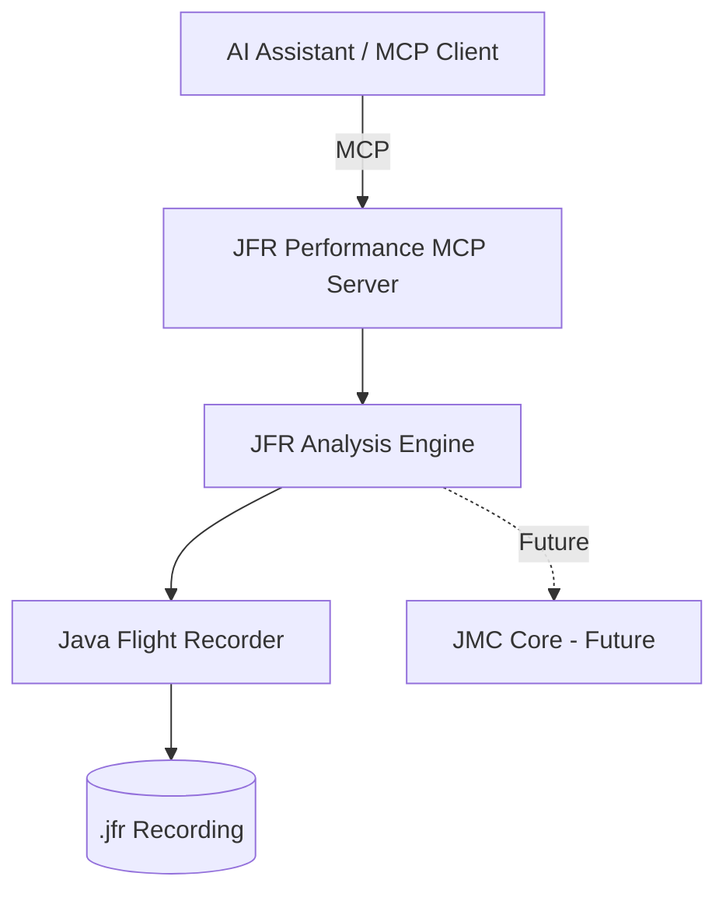

# jfr-performance-mcp

> **Give Your JVM an AI Assistant: JFR, JDK Mission Control and MCP for Production Performance**

`jfr-performance-mcp` is an enterprise-grade Model Context Protocol (MCP) server that empowers AI assistants to investigate Java Flight Recorder (`.jfr`) recordings and answer production JVM performance questions using actual JVM runtime evidence.

---

## The Central Design Principle

> **DO NOT ask the LLM to guess JVM problems.**  
> **Give the LLM structured JVM evidence through MCP tools.**

LLMs excel at pattern recognition, code analysis, and architectural reasoning—but they fail when asked to guess why a production JVM is slow based only on stack traces or high-level symptoms. `jfr-performance-mcp` provides a structured evidence layer that extracts measured facts (CPU samples, monitor contention timings, GC pause durations, allocation rates, and thread states) and presents them to the AI model so it can reason with confidence.

---

## Architecture Overview

`jfr-performance-mcp` is built on a clean three-layer architecture that strictly decouples JFR analysis from protocol adapters:



- **Layer 1 — JFR Analysis Engine (`com.ravi.jfrmcp.jfr`)**: Independent of MCP and presentation layers. Safely reads and streams events using `jdk.jfr.consumer.RecordingFile` without exhausting heap memory, backed by LRU result caching.
- **Layer 2 — Domain Model (`com.ravi.jfrmcp.model`)**: Structured Java records representing JVM performance findings, factual evidence (`Evidence`), severity levels, and investigation next steps.
- **Layer 3 — MCP Adapter (`com.ravi.jfrmcp.mcp`)**: Implements the official MCP Java SDK (STDIO transport) with structured JSON-RPC messaging, strict STDERR diagnostic logging, and security boundary enforcement.

---

## Quick Start

### 1. Build the Executable JAR

Requires Java 21+ and Maven 3.9+:

```bash
git clone https://github.com/ravi/jfr-performance-mcp.git
cd jfr-performance-mcp
./scripts/build.sh
```

This compiles, runs 40 automated tests, and packages the standalone fat JAR at:
```
target/jfr-performance-mcp-1.0.0.jar
```

### 2. Standalone CLI Diagnostic Mode

You can immediately analyze a recording from the command line without starting an MCP client:

```bash
./scripts/run.sh --analyze recordings/demo-production.jfr
```

### 3. Connect to an AI Assistant via MCP

Configure your MCP client (Google Antigravity, Claude Desktop, Cursor, or VS Code):

```json
{
  "mcpServers": {
    "jfr-performance": {
      "command": "java",
      "args": [
        "-jar",
        "/ABSOLUTE/PATH/TO/jfr-performance-mcp/target/jfr-performance-mcp-1.0.0.jar"
      ],
      "env": {
        "JFR_RECORDINGS_DIR": "/ABSOLUTE/PATH/TO/jfr-performance-mcp/recordings"
      }
    }
  }
}
```

---

## Available MCP Tools

`jfr-performance-mcp` exposes 11 tools designed specifically for AI reasoning:

| Tool | Purpose | Key Inputs |
|------|---------|------------|
| `list_recordings` | Discovers available `.jfr` recordings in the configured directory | `directory` (optional) |
| `recording_summary` | Returns recording metadata, timeframe, JVM configuration, and event counts | `recording` (required) |
| `analyze_cpu` | Analyzes execution samples and CPU load to find CPU hotspots | `recording`, `topN` |
| `analyze_gc` | Analyzes GC pause times, young/old collections, and heap occupancy | `recording` |
| `analyze_allocation` | Evaluates memory allocation pressure, top allocating classes, and rates | `recording`, `topN` |
| `analyze_threads` | Summarizes thread execution states, thread counts, and per-thread CPU | `recording` |
| `analyze_locks` | Analyzes monitor enter events to detect thread serialization bottlenecks | `recording`, `topN` |
| `analyze_exceptions` | Identifies exception storms, top throwing classes, and fatal JVM errors | `recording`, `topN` |
| `analyze_io` | Measures File and Socket I/O operation counts, byte volumes, and slow events | `recording`, `topN` |
| `analyze_latency` | Identifies outlier latency events exceeding a threshold (default 100ms) | `recording`, `thresholdMs` |
| `analyze_recording` | Comprehensive multi-dimensional triage correlating all evidence | `recording` |

See [docs/tools.md](docs/tools.md) for full parameter schemas and example JSON responses.

---

## Example Questions to Ask Your AI Assistant

Once connected, you can ask your AI assistant questions such as:

- *"Analyze `demo-production.jfr` and identify the strongest performance bottleneck."*
- *"Why is CPU usage high? What methods dominate execution samples?"*
- *"Is garbage collection pause time causing latency spikes?"*
- *"Are there blocked threads? Which synchronized locks are causing contention?"*
- *"What should I investigate in the source code based on the JFR evidence?"*
- *"What evidence supports your conclusion that GC is healthy?"*

---

## AI Safety and Investigation Principles

- **Strictly Read-Only**: The server contains no tools to restart JVMs, modify flags, kill processes, or execute arbitrary code.
- **Evidence Separation**: The system separates **FACTS** (measured metrics in `Evidence`) from **INTERPRETATION** (findings) and **RECOMMENDATION** (investigation next steps).
- **Nuanced Confidence**: Tools use calibrated language (*"strong evidence"*, *"likely"*, *"possible"*, *"no significant evidence found"*) rather than absolute claims.

---

## Limitations

1. **Sampled Nature of JFR**: JFR execution profiling and object allocations rely on sampling. Sample percentages reflect statistical distribution rather than exact nanosecond accounting.
2. **Absence of Evidence is Not Proof of Absence**: If an event type is disabled in the recording profile (e.g. socket read events disabled), the tool reports zero events but cannot guarantee no socket I/O occurred.
3. **Application Latency Context**: JFR measures JVM-level pauses, waits, and I/O; it does not measure end-to-end user HTTP latency unless custom application events or OpenTelemetry spans were recorded.
4. **Human Verification**: AI conclusions are recommendations based on runtime evidence; production changes must always be peer-reviewed and tested.

---

## Project Documentation

- [docs/architecture.md](docs/architecture.md) — Three-layer architecture, caching, and security design
- [docs/tools.md](docs/tools.md) — Detailed schemas and specifications for all 11 MCP tools
- [docs/development.md](docs/development.md) — Build, test, debug, and contribution guide
- [docs/demo.md](docs/demo.md) — Conference presentation scenario and demo walkthrough
- [docs/antigravity.md](docs/antigravity.md) — Google Antigravity setup and configuration guide

---

## License

This project is licensed under the Apache License 2.0. See [LICENSE](LICENSE) for details.
