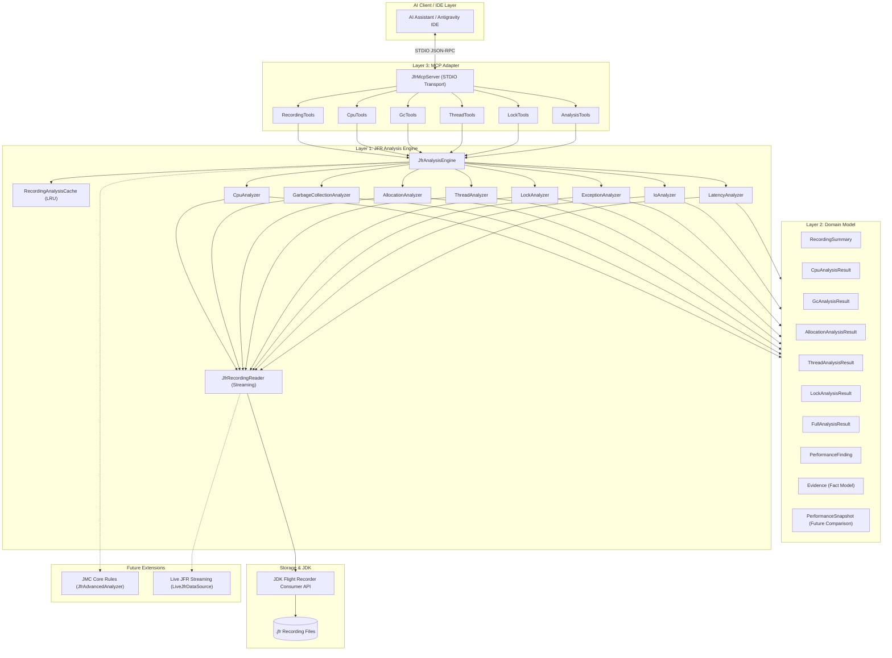

# Architecture: jfr-performance-mcp

`jfr-performance-mcp` is designed as a production-quality, read-only JVM performance analysis server providing structured runtime evidence to AI assistants and LLMs via the Model Context Protocol (MCP).

## Core Principle: Evidence Over Guesswork

A common failure mode of AI-assisted performance troubleshooting is asking the LLM to guess root causes from generic logs, symptom snippets, or hallucinated JVM behavior.

The central design principle of `jfr-performance-mcp` is:
> **DO NOT ask the LLM to guess JVM problems.**  
> **Give the LLM structured JVM evidence through MCP tools.**

The AI assistant acts as an investigator that inspects measured facts (event counts, pause times, sample distributions, thread states, monitor contention records) and uses this evidence to reason and formulate hypotheses.

---

## Three-Layer Architecture

The codebase strictly decouples JFR analysis from protocol adapters across three distinct layers:

---

### Layer 1 — JFR Analysis Engine (`com.ravi.jfrmcp.jfr`)

Responsible **only** for reading and analyzing `.jfr` recordings. It contains **no knowledge of MCP, JSON-RPC, or AI transports**.

Key components:
- **`JfrRecordingReader`**: Wraps `jdk.jfr.consumer.RecordingFile` to safely iterate and stream events sequentially without loading entire recordings into heap memory.
- **`JfrEventFilter`**: Event-type and timeframe predicate for zero-copy streaming.
- **`JfrEventUtils`**: Safe extraction of stack traces, method signatures, thread names, and metric values.
- **`RecordingAnalysisCache` & `InMemoryRecordingAnalysisCache`**: Thread-safe LRU caching keyed on canonical file path, file size, and last-modified timestamp.
- **`JfrAnalyzer<R>`**: Domain analyzer implementations:
  - `RecordingSummaryAnalyzer`: Recording metadata, JVM configuration, event types.
  - `CpuAnalyzer`: Execution sample distributions, top methods, classes, and packages.
  - `GarbageCollectionAnalyzer`: Stop-the-world pauses, young vs. old collections, heap occupancy.
  - `AllocationAnalyzer`: TLAB and outside-TLAB allocation pressure and rates.
  - `ThreadAnalyzer`: Concurrency levels, states (RUNNABLE, BLOCKED, WAITING, PARKED), thread CPU shares.
  - `LockAnalyzer`: Java monitor enter contention, blocked thread counts, and cumulative serialized time.
  - `ExceptionAnalyzer`: Thrown exceptions, exception storms, JVM fatal errors.
  - `IoAnalyzer`: Socket and file read/write latency and slow operations.
  - `LatencyAnalyzer`: Outlier events exceeding configured latency thresholds.
- **`JfrAnalysisEngine`**: Orchestrates individual analyzers, manages cache lookups, and correlates multi-dimensional findings in `analyzeRecording`.

### Layer 2 — Domain Model (`com.ravi.jfrmcp.model`)

Independent Java records and immutable DTOs representing JVM performance domain concepts:
- **`Evidence`**: Unambiguous, measured facts (`metric`, `value`, `unit`, `source`, `confidence`, `description`). Separates **facts** from **interpretations** and **recommendations**.
- **`PerformanceFinding`**: An analytical finding (`category`, `severity`, `confidence`, `title`, `summary`, `evidence`, `impact`, `recommendedInvestigation`).
- **`FindingSeverity`**: `INFO`, `LOW`, `MEDIUM`, `HIGH`, `CRITICAL`.
- **`FindingCategory`**: `CPU`, `GC`, `ALLOCATION`, `THREAD`, `LOCK_CONTENTION`, `EXCEPTION`, `IO`, `LATENCY`, `JVM_CONFIGURATION`, `OTHER`.
- **`PerformanceSnapshot`**: Domain abstraction capturing key metrics for future before/after regressions and comparison (`compare_recordings`).

### Layer 3 — MCP Adapter (`com.ravi.jfrmcp.mcp`)

Exposes the analysis engine as standard MCP tools via the official MCP Java SDK:
- Uses `StdioServerTransportProvider` over standard I/O.
- Strict isolation: **All logging is routed exclusively to `STDERR`** via Logback, ensuring STDOUT carries only pure JSON-RPC messages.
- Structured error handling: Returns `isError: true` with standard `errorCode` and descriptive messages instead of raw stack traces.
- Prompt-engineered tool descriptions guiding AI models on when and how to invoke each tool.

---

## Security Boundaries

1. **Recording Directory Confinement**: All file lookups are restricted to the configured `JFR_RECORDINGS_DIR` (default `./recordings`).
2. **Path Traversal Prevention**: Any path containing `..` or resolving outside the canonical base directory is immediately rejected with `RECORDING_ACCESS_DENIED`.
3. **Symlink Escape Protection**: Validates canonical paths (`toRealPath()`) to prevent symlink-based escapes.
4. **Read-Only Operation**: The server contains no modification, process execution, or JVM manipulation tools.

---

## Future Readiness & Extensibility

- **JMC Core Integration**: The `JfrAdvancedAnalyzer` interface provides an extension hook for plugging in `org.openjdk.jmc.flightrecorder.rules` without modifying the core MCP server.
- **Live Event Streaming**: The `JfrDataSource` abstraction (`FileJfrDataSource`, future `LiveJfrDataSource`) decouples offline file consumption from live JVM streaming (`jdk.jfr.consumer.EventStream`).
- **Differential Analysis**: The `PerformanceSnapshot` record prepares the data model for the future `compare_recordings` tool.
