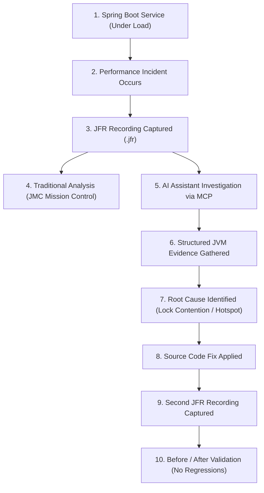

# Conference Demo Guide: Give Your JVM an AI Assistant

**Presentation Title:**  
*"Give Your JVM an AI Assistant: JFR, JDK Mission Control and MCP for Production Performance"*

This document describes the end-to-end conference demonstration flow using `jfr-performance-mcp`.

---

## 1. Demonstration Scenario

A production Spring Boot e-commerce microservice begins experiencing latency spikes, elevated response times, and increased CPU load during a high-traffic campaign.

The operations team captures a Java Flight Recorder recording:
```bash
jcmd <pid> JFR.start name=incident duration=120s filename=production-incident.jfr settings=profile.jfc
```

Rather than guessing the problem from logs or stack trace snippets, the engineer connects an AI assistant via MCP to inspect the recording.

---

## 2. Demonstration Flow Diagram



---

## 3. Step-by-Step Walkthrough

### Step 1: Environment Discovery
**User Prompt:**
> "What JFR recordings do we have available to investigate?"

**AI MCP Call:**
```json
{
  "name": "list_recordings",
  "arguments": {}
}
```

**AI Response:**
> "I found recording `production-incident.jfr` (148 KB, captured from OpenJDK 25)."

---

### Step 2: High-Level Automated Triage
**User Prompt:**
> "Analyze `production-incident.jfr` and tell me what is causing the latency."

**AI MCP Call:**
```json
{
  "name": "analyze_recording",
  "arguments": { "recording": "production-incident.jfr" }
}
```

**MCP Evidence Returned:**
- **Overall Assessment**: `HIGH`
- **Finding 1**: Dominant CPU Hotspot in `OrderService.calculatePrice()` (96% of CPU execution samples).
- **Finding 2**: Severe Java monitor lock contention on `InventoryService` (5 blocked threads, 2.7s cumulative serialization time).
- **Healthy Areas**: Garbage Collection pause times are nominal (<10ms pause); no JVM fatal errors or OOM conditions.

**AI Synthesis:**
> "The strongest signals in the recording are:
> 1. **Thread Monitor Contention (`HIGH`)**: 5 worker threads spent 2.7 seconds blocked waiting to enter a synchronized monitor around `InventoryService`.
> 2. **CPU Hotspot (`HIGH`)**: 96% of captured CPU execution samples are spent inside `OrderService.calculatePrice()`.
> 3. **Healthy Area**: Garbage collection is not responsible for the latency spikes (maximum pause was only 9.2ms)."

---

### Step 3: Deep-Dive into Contention Hotspot
**User Prompt:**
> "Show me the exact lock contention evidence and which threads are involved."

**AI MCP Call:**
```json
{
  "name": "analyze_locks",
  "arguments": {
    "recording": "production-incident.jfr",
    "topN": 5
  }
}
```

**Evidence Returned:**
- Contended monitor: `com.ravi.jfrmcp.TestRecordingFactory$InventoryService`
- Blocked threads: `InventoryWorker-0`, `InventoryWorker-1`, `InventoryWorker-2`
- Sample stack trace pinpointing the critical section at `InventoryService.processOrder():32`.

---

### Step 4: AI Recommendations & Source Code Fix
**AI Reasoning**:
1. Replace the coarse-grained `synchronized` lock on `InventoryService` with concurrent collections or fine-grained optimistic locking (`StampedLock` or `ConcurrentHashMap`).
2. Optimize trigonometric calculations or cache results in `OrderService.calculatePrice()`.

---

### Step 5: Verification & Validation
1. Deploy code fix to staging environment.
2. Capture a post-fix recording: `production-fixed.jfr`.
3. Run `analyze_recording` on `production-fixed.jfr`.
4. Validate that monitor contention has dropped to zero and CPU load is balanced.
